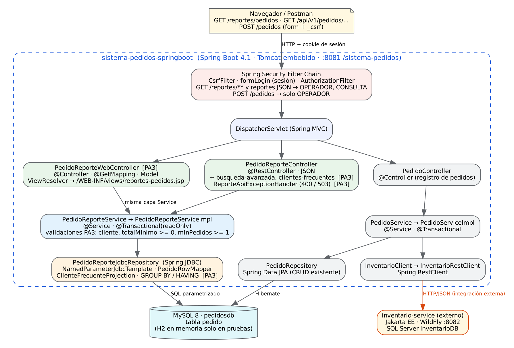

# Sistema de Pedidos — PA3: módulo de consulta y supervisión de pedidos

> **Curso:** Desarrollo de Aplicaciones Empresariales Avanzado · ISIL · NRC 4622 · Periodo 2026-20
> **Estudiante:** Veronica Delgado · **Docente:** Carlos Augusto Nole Machaca
> **Rama evaluada:** `feature/pa3-delgado` (también integrada en `main`)
> **Proyecto base:** [`carnol1989/isil-2026-ii`](https://github.com/carnol1989/isil-2026-ii), rama `feature/sistema-pedidos-spring-jdbc`, carpeta `Sesión 5/sistema-pedidos-springboot` (commit `4edae85`).

Este repositorio contiene el proyecto **Spring Boot completo** (`pom.xml` en la raíz). La PA3 agrega un módulo de reportes de solo lectura que integra:

- **Spring MVC + JSP:** nueva vista `GET /reportes/pedidos` (`@Controller`, `Model`, ViewResolver).
- **API REST/JSON:** `GET /api/v1/pedidos/busqueda-avanzada` y `GET /api/v1/pedidos/clientes-frecuentes`.
- **Spring JDBC:** dos consultas nuevas con `NamedParameterJdbcTemplate` y SQL parametrizado (una con `GROUP BY` + `HAVING`).
- **Spring Security:** acceso explícito por roles `OPERADOR` y `CONSULTA`, CSRF habilitado.
- **20 pruebas automatizadas nuevas** (JUnit 5, Mockito, MockMvc, H2).

El CRUD existente con **Spring Data JPA** y la integración HTTP con **inventario-service** se conservan sin cambios: JPA para la operación transaccional y JDBC para los reportes.

> La documentación original del docente se conserva en [`docs/README-proyecto-base-docente.md`](docs/README-proyecto-base-docente.md).

---

## 1. Tecnologías

| Capa | Tecnología |
|---|---|
| Lenguaje / build | Java 21 · Maven (wrapper `mvnw` incluido) |
| Framework | Spring Boot 4.1.1 (Spring Framework 7) |
| Web | Spring MVC · JSP + JSTL (Tomcat Jasper) · empaquetado WAR |
| API | `@RestController` · JSON · Spring HATEOAS (endpoints base) |
| Seguridad | Spring Security · `formLogin` · usuarios en memoria (BCrypt) · CSRF |
| Persistencia | Spring Data JPA (CRUD) + **Spring JDBC** (`JdbcTemplate`, `NamedParameterJdbcTemplate`) |
| Base de datos | **MySQL 8** en ejecución normal · **H2** en memoria solo para pruebas (`application-test.properties`) |
| Integración | Spring `RestClient` → `inventario-service` (Jakarta EE / WildFly :8082) |
| Pruebas | JUnit 5 · Mockito · Spring Test / MockMvc · Spring Security Test |

## 2. Arquitectura



Fuente editable: [`docs/arquitectura-pa3.dot`](docs/arquitectura-pa3.dot) (también en SVG).

```text
Navegador / Postman
   │ HTTP + cookie de sesión
   ▼
Spring Security Filter Chain  (CSRF · formLogin · autorización por rol)
   ▼
DispatcherServlet
   ├─► PedidoReporteWebController (@Controller, Model → reportes-pedidos.jsp)   [PA3]
   ├─► PedidoReporteController    (@RestController, JSON)                        [+PA3]
   └─► PedidoController           (@Controller, registro de pedidos)
          │                                   │
          ▼                                   ▼
   PedidoReporteService(Impl)  [validaciones PA3]     PedidoService(Impl)
          │                                   │                 │
          ▼                                   ▼                 ▼
   PedidoReporteJdbcRepository (Spring JDBC)   PedidoRepository (JPA)   InventarioRestClient
          │                                   │                 │ HTTP/JSON
          └──────────────► MySQL pedidosdb ◄──┘                 ▼
                                                         inventario-service (externo)
```

**Regla clave:** la vista JSP y la API JSON llaman al **mismo** `PedidoReporteService`. Ningún controlador contiene SQL ni reglas de validación.

## 3. Cambios realizados en la PA3 (por capa)

| Capa | Archivo | Cambio |
|---|---|---|
| Repository (JDBC) | `repository/PedidoReporteJdbcRepository.java` | `buscarPedidosPorClienteYTotalMinimo(cliente, totalMinimo)` y `listarClientesFrecuentes(minPedidos)` |
| Proyección | `repository/projection/ClienteFrecuenteProjection.java` **(nuevo)** | Resultado agregado por cliente |
| Service | `service/PedidoReporteService.java`, `service/impl/PedidoReporteServiceImpl.java` | Operaciones nuevas + validaciones (`cliente` no vacío, `totalMinimo >= 0`, `minPedidos >= 1`) |
| Dominio | `service/domain/ClienteFrecuente.java` **(nuevo)** | Modelo de servicio |
| Excepción | `exception/ParametroReporteInvalidoException.java` **(nuevo)** | Parámetro de reporte inválido (→ 400) |
| API REST | `controller/PedidoReporteController.java` | 2 endpoints nuevos |
| Errores API | `controller/ReporteApiExceptionHandler.java` **(nuevo)**, `controller/dto/ErrorResponse.java` **(nuevo)** | 400 parámetro inválido / formato inválido; 503 `DataAccessException` |
| DTO | `controller/dto/ClienteFrecuenteDto.java` **(nuevo)** | Contrato JSON |
| MVC | `controller/PedidoReporteWebController.java` **(nuevo)** | `GET /reportes/pedidos` con `Model` |
| Vista | `webapp/WEB-INF/views/reportes-pedidos.jsp` **(nuevo)**, `pedidos.jsp`, `assets/css/app.css` | Vista de reportes y enlace de navegación |
| Seguridad | `config/SecurityConfig.java` | Reglas explícitas para `/reportes/**` y endpoints de reportes |
| Config | `resources/application.properties` | URL MySQL por defecto con `allowPublicKeyRetrieval` (credenciales siguen externalizadas) |
| BD | `database/Script_BD_usuario_MySql.sql`, `database/pa3_*.sql` **(nuevos)** | Creación de BD/usuario y consultas de verificación |
| Pruebas | 3 clases nuevas + `support/ReportesPa3DatosPrueba.java` | 20 pruebas nuevas |

### 3.1 Consultas Spring JDBC

**Consulta 1 – búsqueda avanzada** (`NamedParameterJdbcTemplate`, reutiliza `PedidoRowMapper`):

```sql
SELECT id, cliente, producto_codigo, producto_nombre, precio_unitario, cantidad, total, fecha
FROM pedido
WHERE LOWER(cliente) LIKE LOWER(:cliente) ESCAPE '!'
  AND total >= :totalMinimo
ORDER BY id DESC
```

**Consulta 2 – clientes frecuentes** (proyección `ClienteFrecuenteProjection`):

```sql
SELECT cliente,
       COUNT(*)      AS total_pedidos,
       SUM(cantidad) AS total_unidades,
       SUM(total)    AS importe_acumulado,
       AVG(total)    AS ticket_promedio
FROM pedido
GROUP BY cliente
HAVING COUNT(*) >= :minPedidos
ORDER BY total_pedidos DESC, importe_acumulado DESC, cliente ASC
```

- Los valores del usuario viajan como **parámetros con nombre**; nunca se concatenan. Los comodines `%` y `_` que escriba el usuario se escapan para buscarse literalmente.
- `ticketPromedio` se normaliza a 2 decimales porque MySQL y H2 devuelven `AVG(DECIMAL)` con escalas distintas.
- `DataAccessException` no se captura para imprimirla: se traduce a **HTTP 503** con un mensaje útil (API) o a la página de error con 503 (vista).

## 4. Requisitos

- **JDK 21** (`java -version`) y Maven 3.9+ o el wrapper incluido.
- **MySQL 8.x** en `localhost:3306`.
- **inventario-service** (proyecto del docente, `Sesión 4/inventario-service`) en WildFly `http://localhost:8082` con SQL Server. No se modificó para la PA3.
- Puerto **8081** libre.

## 5. Base de datos y variables de entorno

1. Crear la base y el usuario de laboratorio (como `root`):

   ```bash
   mysql -u root -p < database/Script_BD_usuario_MySql.sql
   ```

   Crea `pedidosdb` y el usuario `spedidos_app`. La tabla `pedido` la crea Hibernate al iniciar (`ddl-auto=update`).

2. Las credenciales se leen de variables de entorno (con valores de laboratorio por defecto):

   | Variable | Valor por defecto |
   |---|---|
   | `DB_URL` | `jdbc:mysql://localhost:3306/pedidosdb?useSSL=false&allowPublicKeyRetrieval=true&serverTimezone=America/Lima` |
   | `DB_USERNAME` | `spedidos_app` |
   | `DB_PASSWORD` | contraseña de laboratorio del script (cámbiela en entornos reales) |
   | `PEDIDOS_OPERADOR_PASSWORD` | `OperadorDemo2026!` (solo laboratorio) |
   | `PEDIDOS_CONSULTA_PASSWORD` | `ConsultaDemo2026!` (solo laboratorio) |

   PowerShell:

   ```powershell
   $env:DB_URL = "jdbc:mysql://localhost:3306/pedidosdb?useSSL=false&allowPublicKeyRetrieval=true&serverTimezone=America/Lima"
   $env:DB_USERNAME = "spedidos_app"
   $env:DB_PASSWORD = "<clave-local>"
   ```

   No se agregaron contraseñas reales al repositorio.

## 6. Orden de arranque

1. **MySQL** encendido (base `pedidosdb` creada).
2. **inventario-service**: SQL Server + WildFly (`mvn clean wildfly:run` en su proyecto) → verificar `http://localhost:8082/inventario-service/api/inventario/productos`.
3. **Sistema de Pedidos**:

   ```powershell
   .\mvnw.cmd clean test
   .\mvnw.cmd spring-boot:run
   ```

4. Abrir `http://localhost:8081/sistema-pedidos/` e iniciar sesión.

## 7. Usuarios y roles de laboratorio

| Usuario | Rol | Contraseña (solo laboratorio) |
|---|---|---|
| `operador` | `OPERADOR` | `OperadorDemo2026!` |
| `consulta` | `CONSULTA` | `ConsultaDemo2026!` |

### Matriz de accesos (PA3)

| Operación | Anónimo | `CONSULTA` | `OPERADOR` |
|---|---|---|---|
| `GET /reportes/pedidos` | Redirección a `/login` | ✅ 200 | ✅ 200 |
| `GET /api/v1/pedidos/busqueda-avanzada` | Redirección a `/login` | ✅ 200 | ✅ 200 |
| `GET /api/v1/pedidos/clientes-frecuentes` | Redirección a `/login` | ✅ 200 | ✅ 200 |
| `POST/PUT/DELETE /reportes/**` | ❌ rechazado | ❌ 403 | ❌ 403 |
| `POST /pedidos` con CSRF válido | Redirección a `/login` | ❌ 403 | ✅ (si cumple reglas de negocio) |
| `POST /pedidos` sin CSRF | ❌ 403 | ❌ 403 | ❌ 403 |

CSRF **no** se desactivó: el formulario de pedidos y el logout envían `_csrf`.

## 8. Rutas nuevas y ejemplos

Las rutas se escriben sin el contexto; en el navegador anteponer `http://localhost:8081/sistema-pedidos`.

| Método | Ruta | Respuesta |
|---|---|---|
| GET | `/reportes/pedidos` | HTML (JSP) con resumen, búsqueda avanzada y clientes frecuentes |
| GET | `/reportes/pedidos?cliente=Ana&totalMinimo=1000&minPedidos=2` | HTML con ambos reportes ejecutados |
| GET | `/api/v1/pedidos/busqueda-avanzada?cliente=Ana&totalMinimo=1000` | `200` JSON: arreglo de `PedidoResponse` |
| GET | `/api/v1/pedidos/clientes-frecuentes?minPedidos=2` | `200` JSON: arreglo de `ClienteFrecuenteDto` |

Ejemplo `GET /api/v1/pedidos/clientes-frecuentes?minPedidos=2`:

```json
[
  { "cliente": "Ana Torres", "totalPedidos": 3, "totalUnidades": 4,
    "importeAcumulado": 4320.00, "ticketPromedio": 1440.00 },
  { "cliente": "Luis Ramos", "totalPedidos": 2, "totalUnidades": 4,
    "importeAcumulado": 2860.00, "ticketPromedio": 1430.00 }
]
```

Ejemplo de error `GET /api/v1/pedidos/clientes-frecuentes?minPedidos=0` → **400**:

```json
{
  "timestamp": "2026-11-10T15:04:12.345Z",
  "status": 400,
  "error": "Bad Request",
  "mensaje": "El parámetro minPedidos debe ser mayor o igual a 1.",
  "parametro": "minPedidos",
  "path": "/sistema-pedidos/api/v1/pedidos/clientes-frecuentes"
}
```

| Situación | Código |
|---|---|
| Consulta válida (con o sin resultados) | 200 |
| `cliente` vacío, `totalMinimo` negativo o ausente, `minPedidos < 1` o ausente, número mal formado | 400 |
| Base de datos no disponible (`DataAccessException`) | 503 |
| Usuario anónimo | 302 → `/login` |
| Método no permitido para el rol / sin CSRF | 403 |

## 9. Pruebas automatizadas

```powershell
.\mvnw.cmd clean test
```

`mvn test` usa el perfil `test` (H2 en memoria): **no requiere MySQL ni inventario-service**.

### Pruebas nuevas de la PA3 (20)

| Clase | Tipo | Pruebas |
|---|---|---|
| `repository/PedidoReporteJdbcRepositoryPa3Test` | Integración Spring JDBC + H2 | Búsqueda avanzada filtra y ordena por id DESC · límite inclusivo `total >= totalMinimo` · inyección SQL y comodines no alteran el resultado ni la tabla · `GROUP BY/HAVING` con valores agregados correctos · umbral sin coincidencias |
| `service/impl/PedidoReporteServiceImplPa3Test` | Unitaria con Mockito | `minPedidos=0`, `totalMinimo` negativo/ausente y `cliente` vacío se rechazan **sin invocar el repositorio** · delega parámetros válidos (con `trim`) · mapea proyección a dominio |
| `controller/PedidoReportePa3IntegrationTest` | Integración MockMvc + Spring Security + H2 | CONSULTA obtiene la vista `reportes-pedidos` con `Model` · anónimo → login · `minPedidos=0` → 400 en la vista · POST a reportes → 403 · JSON de búsqueda avanzada y clientes frecuentes · 400 JSON para parámetros inválidos y formato inválido |

Datos de prueba compartidos: `support/ReportesPa3DatosPrueba` (mismo escenario que las evidencias manuales). Todas las pruebas siguen el patrón **Arrange – Act – Assert**.

## 10. Verificación manual (cinco casos)

El procedimiento reproducible de los cinco casos funcionales está en [`docs/VERIFICACION_MANUAL_PA3.md`](docs/VERIFICACION_MANUAL_PA3.md); las consultas para contrastar con MySQL están en [`database/pa3_consultas_verificacion.sql`](database/pa3_consultas_verificacion.sql).

## 11. Limitaciones

- Usuarios en memoria y contraseñas de laboratorio; no hay JWT, OAuth2/OIDC ni usuarios persistidos (no requerido).
- Los endpoints JSON usan la sesión de `formLogin`; desde Postman hay que iniciar sesión y conservar la cookie (no se habilitó HTTP Basic).
- `GROUP BY cliente` agrupa por el texto exacto del cliente: en MySQL (collation insensible a mayúsculas) "Ana Torres" y "ana torres" se agrupan juntos; en H2 no. El servicio ya guarda el cliente con `trim()`.
- La búsqueda por cliente usa `LIKE '%texto%'`, que no aprovecha índices; para grandes volúmenes convendría paginación e índices/búsqueda de texto completo.
- Sin paginación en los reportes.
- `ddl-auto=update` es apropiado para laboratorio; en producción se recomiendan migraciones (Flyway/Liquibase).
- La reserva de stock en inventario-service y el INSERT local no forman una transacción distribuida (ver PA2).

## 12. Referencias

- Spring. (2026). *Data access with JDBC*. Spring Framework Reference. https://docs.spring.io/spring-framework/reference/data-access/jdbc.html
- Spring. (2026). *Spring Web MVC*. Spring Framework Reference. https://docs.spring.io/spring-framework/reference/web/webmvc.html
- Spring. (2026). *Authorize HttpServletRequests*. Spring Security Reference. https://docs.spring.io/spring-security/reference/servlet/authorization/authorize-http-requests.html
- Spring. (2026). *Cross Site Request Forgery (CSRF)*. Spring Security Reference. https://docs.spring.io/spring-security/reference/servlet/exploits/csrf.html
- Spring. (2026). *Testing with MockMvc*. Spring Security Reference. https://docs.spring.io/spring-security/reference/servlet/test/mockmvc/index.html
